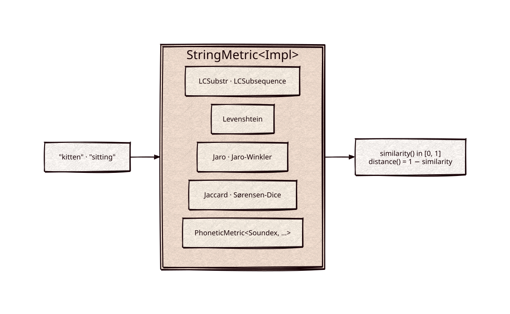

# string-similarity

Part of [Kronuz C++ Libraries](https://github.com/Kronuz/cpp-libraries), a collection of small, reusable C++ libraries.

[](https://github.com/Kronuz/string-similarity/actions/workflows/ci.yml)
[](LICENSE)


String similarity metrics for C++20 behind one interface: Levenshtein, Jaro and
Jaro-Winkler, longest common substring and subsequence, Jaccard, Sørensen-Dice,
and a phonetic wrapper, each scoring in `[0, 1]`. For fuzzy matching,
suggestions, and deduplication.



## ✨ Highlights

- **Seven metrics, one interface.** Each has `similarity()` and `distance()` in
  `[0, 1]`, plus `name()` and `description()`.
- **Compare many against one.** Bind one side in the constructor and score others
  against it.
- **Sounds-alike matching.** `PhoneticMetric<SoundexEnglish, Levenshtein>`
  compares Soundex codes, so "Robert" and "Rupert" match.
- **Case-insensitive by default**, with a flag to turn it off.

## 📦 Installation

Requires a C++20 compiler and CMake 3.14 or newer; it fetches
[strings](https://github.com/Kronuz/strings) and
[soundex](https://github.com/Kronuz/soundex). CI builds it on Linux (x86_64,
arm64), macOS (arm64, x86_64), and FreeBSD, plus ASan, UBSan, and TSan builds.

```cmake
include(FetchContent)
FetchContent_Declare(string_similarity
  GIT_REPOSITORY https://github.com/Kronuz/string-similarity.git
  GIT_TAG        main)
FetchContent_MakeAvailable(string_similarity)

target_link_libraries(my_app PRIVATE string_similarity::string_similarity)
```

## 🚀 Quick start

```cpp
#include "levenshtein.h"
#include "jaro_winkler.h"
#include "phonetic_metric.h"
#include "english_soundex.h"

#include <cstdio>
#include <string>

int main() {
	Levenshtein lev;
	std::printf("%.3f\n", lev.similarity(std::string("kitten"), std::string("sitting")));   // 1 - 3/7

	Jaro_Winkler jw;
	std::printf("%.3f\n", jw.similarity(std::string("MARTHA"), std::string("MARHTA")));

	PhoneticMetric<SoundexEnglish, Levenshtein> sounds_like("Robert");
	std::printf("%.3f\n", sounds_like.similarity(std::string("Rupert")));      // same Soundex code
}
```

[`examples/demo.cc`](examples/demo.cc) prints every metric for several pairs.

## 🎯 When to use it

- ✅ Ranking candidate spellings, matching names, or flagging near-duplicates.
- ❌ Searching a large corpus for close matches: these compare one pair at a
  time; use an index (n-grams, BK-trees) to find candidates first.
- ❌ Unicode-aware comparison: metrics and case folding work byte by byte.

## 📚 Documentation

- [docs/API.md](docs/API.md): each metric and how to call it.
- [ARCHITECTURE.md](ARCHITECTURE.md): the CRTP base and how each metric
  normalizes.
- [AGENTS.md](AGENTS.md): repository map, invariants, and traps.

## 🛠️ Building and testing

```sh
cmake -B build && cmake --build build && ctest --test-dir build
./build/string_similarity_demo
```

## 🤝 Contributing

Issues and pull requests are welcome. Read [AGENTS.md](AGENTS.md) first. CI must
pass on every platform.

## 📄 License

MIT, Copyright (c) 2015-2018 Dubalu LLC. See [LICENSE](LICENSE). Extracted from
[Xapiand](https://github.com/Kronuz/Xapiand).
